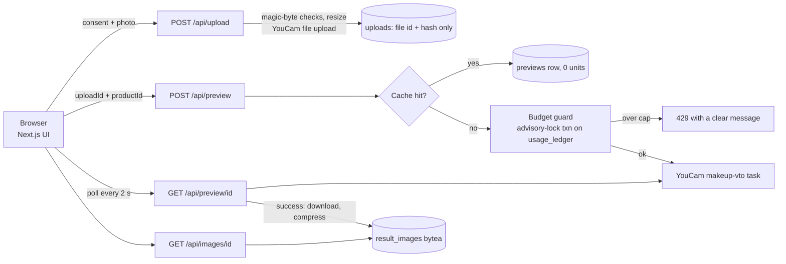

# CounterReady

> **Choose from what the shop actually sells, not an endless palette of colours.**

CounterReady is a budget-first makeup consultation covering **lipstick, blush and eyeshadow** built for the **YouCam API Skin AI & eCommerce VTO Hackathon**.
A shopper sets a budget, shortlists up to three products of one type from one shop's catalogue, previews them on the **same photo** with the
**YouCam AI Makeup API**, picks a favourite, and leaves with a **purchase card** and a **comparison receipt** tied to an exact product code and price.

It is one polished customer journey, not a retailer platform. The demo shop is a **manually maintained sample catalogue** of twenty made-up products (8 lipsticks, 6 blushes, 6 eyeshadows), not a live retailer feed.

## The journey

1. **Type and budget**: lipstick, blush or eyeshadow; maximum budget; preferred finish (the options depend on the type, because the API offers different textures for each); optional colour family. Matches appear immediately. If nothing matches, the app says *which filter* caused it instead of quietly showing over-budget items.
2. **Shortlist**: price, finish, shade code and stock status on every card. Out-of-stock shades are visible but cannot be selected. Up to three.
3. **Photo and consent**: an explicit consent checkbox ("Your photo will be sent to Perfect Corp to generate a virtual makeup preview. Digital colours are approximate…"), file upload, phone camera capture, or a clearly labelled sample photo. Consent is also enforced server-side.
4. **Generate and compare**: previews are generated only after pressing the button. Every shade is applied to the *original* uploaded photo (the same provider file), never to another preview. Same size and crop, original shown beside the results, each tile has its own retry.
5. **Decide and save**: pick a favourite, add an optional note, get the **comparison receipt** (budget, products compared, selected product, shade code, finish, listed price, note) and a downloadable **purchase card** (shop name, product, shade code, price, finish, note, contact, a reminder to confirm availability and physical colour). The card is **product-only by default**; the shopper chooses whether their face appears.

## What is real, what is computed

| Source | Examples | Where it shows |
| --- | --- | --- |
| **Generated by YouCam** | The makeup preview image | Labelled "AI preview" |
| **Shop catalogue (sample data)** | Name, shade code, price in PKR, finish, stock | Labelled "Sample product / Sample catalogue" |
| **Shopper's own choices** | Budget, filters, shortlist, favourite, note | The receipt |

`previewHex` is rendering configuration, **not** proof that the physical product has been colour-calibrated. There is no skin analysis, skin-tone classification, suitability score, chatbot, or claim of exact shade matching. Recommendations are plain, visible filters.

Observed behaviour worth knowing: eyeshadow looks subtle on photos where the eyes are partly covered (fringe, glasses); the API can subtly retouch the whole image (skin smoothing and light balancing), not only the lips, and nude shades on lips of a similar colour look subtle. Both are stated honestly rather than hidden.

## YouCam API used

**AI Makeup Virtual Try-On** ([docs](https://docs.perfectcorp.com/reference/description/ai_makeup_vto)), base URL `https://yce-api-01.makeupar.com`, auth `Authorization: Bearer <API key>`, **1 unit per task**.

1. `POST /s2s/v2.0/file`: initialise an upload, receive `file_id` and a signed `PUT` URL; upload the normalised selfie once.
2. `POST /s2s/v2.0/task/makeup-vto` with `src_file_id`, `version: "1.0"` and one effect chosen by product type (`src/lib/youcam/effects.ts`):
   - lipstick: `lip_color` with the `original` shape (gloss also sends `gloss` and `transparencyIntensity`);
   - blush: `blush` with the single-colour pattern `1color1` (satin sends `glowStrength`; shimmer adds `shimmerColor` and `shimmerDensity`);
   - eyeshadow: `eye_shadow` with `1color1` (shimmer adds `shimmerColor` and `shimmerIntensity`; metallic also `metallicIntensity`).

   Colour is the product's `previewHex`, texture is its finish. Eyeliner and eyebrows were left out: eyeliner patterns need multi-colour palettes.
3. `GET /s2s/v2.0/task/makeup-vto/{task_id}`: poll until `task_status` is `success` (`data.results.url`) or `error` (`data.error`, e.g. `error_face_angle_invalid`).

The request shape was verified against the published OpenAPI spec (`fixtures/makeup_vto.openapi.json`) and the live API; a real success response is in `fixtures/makeup-success.json`.
All provider-specific code lives in `src/lib/youcam/` (`client.ts`, `adapter.ts`, `lip.ts`, `errors.ts`). The UI consumes a normalised `PreviewResult`.
Input rules from the docs: long side below 1920 px, face width at least 100 px, under 10 MB, JPG/PNG. We resize to a 1080 px long side, which keeps every preview the same size.

## Architecture



- The photo exists only in server memory while it is forwarded to YouCam. We store the provider file id and a hash, never pixels.
- Result URLs expire, so on success the result is downloaded, compressed and stored in Postgres, then served from `/api/images/[id]`.
- Next.js 16 (App Router, TypeScript strict, Tailwind v4), Zod, Drizzle + Neon, sharp, html-to-image for the card export.

## Unit budget

The demo key has limited units and judges must be able to use the app, so spend is capped in the database, not in the UI:

- `MAX_UNITS_TOTAL` (850) and `MAX_PREVIEWS_PER_SESSION` (8) are enforced from `usage_ledger` inside a transaction guarded by `pg_advisory_xact_lock`, before any YouCam call.
- **Cache**: key = `sha256(photo hash + product + effect settings)`. An identical earlier success is reused for 0 units. The sample photo is read server-side so its hash is stable, and **all 17 in-stock shades are pre-warmed** (`scripts/warm-sample.ts`), so judges using the sample photo spend nothing.
- **No double charge**: the unit is reserved before the call; if the task is never created it is refunded (idempotently). Task creation is never auto-retried. Provider-side errors keep their unit (conservative).
- `/admin?token=…` shows used/remaining units. `/api/health` checks the database. Mock mode (`YOUCAM_MOCK=1`) writes 0-unit rows and returns bundled real results.

## Setup

```bash
npm i
cp .env.example .env.local     # DATABASE_URL, YOUCAM_API_KEY (or YOUCAM_MOCK=1)
npm run db:push                # create tables in Neon
npm run dev
```

| Variable | Purpose |
| --- | --- |
| `DATABASE_URL` | Neon pooled connection string |
| `DATABASE_URL_UNPOOLED` | Neon direct string (used by drizzle-kit if set) |
| `YOUCAM_API_KEY` | YouCam API key (server only) |
| `YOUCAM_BASE_URL` | Defaults to `https://yce-api-01.makeupar.com` |
| `YOUCAM_MOCK` | `1` = no provider calls; returns bundled real results after ~5 s |
| `MAX_UNITS_TOTAL` / `MAX_PREVIEWS_PER_SESSION` | Budget caps (850 / 8) |
| `ADMIN_TOKEN` | Enables `/admin?token=…` |

Scripts: `npm run smoke:lip -- selfie.jpg "#b5485a" satin` (one live call, 1 unit, saves the fixture), `npx tsx scripts/warm-sample.ts` (warm the cache against a running server), `npx tsx scripts/make-product-images.ts`, `npm test`, `npx playwright test`, `npm run typecheck`.

**Deploy (Vercel):** import the repo, set the variables above (Production), set `YOUCAM_MOCK=0` and a strong `ADMIN_TOKEN`. Run `npm run db:push` against the production database first.

## Privacy

The photo is sent to Perfect Corp (YouCam) **only after explicit consent**. CounterReady never writes it to its database, disk or logs. **We do not promise that YouCam deletes it immediately**: retention is governed by YouCam's terms, which we have not verified, and the privacy page says so. While you work, the photo and choices sit in this tab's session storage. The `/privacy` page has a **Delete my data** button that wipes what CounterReady holds (preview records, stored images, upload reference) without ever returning spent credits to the shared budget.

## Testing

Vitest (28 tests): catalogue filters, the "which filter excluded products" explanations, budget guard, the response adapter against the real recorded fixture, effect mapping for all three categories, cache hashing, the receipt, magic-byte sniffing.
Two Playwright tests run in mock mode (a full lipstick journey and a blush journey with a category switch): consent gating, out-of-stock handling, the three-item limit, three previews, the receipt, the PNG download.

## Credits and licence

- Sample photo (`public/sample-photos/sample-1.jpg`): a portrait from [Unsplash](https://unsplash.com), used under the Unsplash licence. **Verify the photographer credit and that you are comfortable processing this person's image before submitting**; replace it with a photo you have explicit permission for if in doubt.
- Product images are generated illustrations (`scripts/make-product-images.ts`), not photographs of real products. All products, the shop and its contact number are fictional sample data.
- Fonts: Inter and Archivo (SIL OFL via `next/font`). Code released under the [MIT licence](LICENSE).
