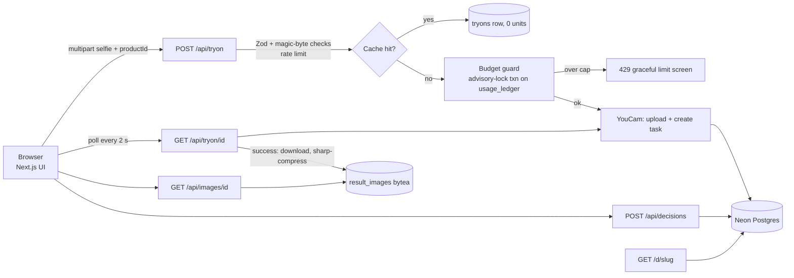

# SmallPrint

> **Looks right. But should I buy it?**

SmallPrint is an earring-shopping decision assistant built for the **YouCam API Skin AI & eCommerce VTO Hackathon**.
A shopper sets a brief (budget, longest drop, fastening, material, occasion), uploads a selfie, and tries on up to three earrings with the
**YouCam Earring VTO API**. The app then shows each AI preview next to the real catalogue facts (drop length, weight, fastening, material,
price, return policy) and produces a shareable **Buy / Maybe / Skip** decision card.

## The problem

A product photo tells you if an earring is beautiful. It can't tell you if it's right for you. Product images are cropped to fill the frame,
so a 1 cm stud and a 9 cm chandelier look the same size ([Baymard: product scale in images](https://baymard.com/research-articles/in-scale-product-images)).
Shoppers find out on delivery, and returns are costly for the seller too. Virtual try-on solves "does it look good"; SmallPrint adds
"is it the right length, weight and risk" in the same view.

## What it does

1. **Brief**: budget, max drop, fastening, material, occasion. Live-filters the catalogue.
2. **Pieces**: 8 catalogue items with real specs and a to-scale drop ruler; shortlist up to 3.
3. **Photo**: drag-drop or phone camera (`capture="user"`), capture guide, consent checkbox, instant client-side validation.
4. **Try on**: one explicit press per product; shimmer skeleton, rotating microcopy, blur-up on arrival, retry states.
5. **Compare**: swipeable on mobile; before/after slider against the original selfie (held only in the browser tab); spec table with the winning cell per row judged against *your* brief; a transparent "fit to your brief" checklist.
6. **Decide + card**: Buy/Maybe/Skip with reason chips, wax-seal verdict stamps, PNG export, print stylesheet, public read-only link `/d/[slug]`.

## What is real, what is computed

| Source | Examples | Where it shows |
| --- | --- | --- |
| **Generated by YouCam** | The try-on preview image | Labelled "AI preview" |
| **Seller catalogue** | Price, drop length, weight, fastening, material, hypoallergenic *declared*, return terms | Labelled "From the seller's catalogue" |
| **Computed by SmallPrint** | "Fit to your brief" (met / partial / miss per criterion), compare-row winners | Labelled "Computed by SmallPrint" |

Limits, stated in the UI as well: the preview is an approximation, not a calibrated measurement (`earring_scale` comes from the catalogue's declared size);
weight, material and hypoallergenic status come from the seller, never the API; SmallPrint never claims an earring is allergy-safe; the fit breakdown is simple
checklist logic, deliberately **not** a scientific-looking score.

## YouCam API used

**AI Earring Virtual Try-On** ([docs](https://docs.perfectcorp.com/reference/ai_earrings)), base URL `https://yce-api-01.makeupar.com`, auth `Authorization: Bearer <API key>`.

1. `POST /s2s/v2.0/file`: initialise an upload, receive `file_id` + signed `PUT` URL; upload the selfie and the single-earring reference image.
2. `POST /s2s/v2.0/task/2d-vto/earring` with `source_info.name` (selfie file id) and `object_infos[0]` (`name` = earring file id, `parameter.earring_scale` in cm, `parameter.earring_is_right_ear`). Returns `data.task_id`.
3. `GET /s2s/v2.0/task/2d-vto/earring/{task_id}`: poll until `task_status` is `success` (`data.results.url`, valid ~2 h) or `error` (`data.error` code).

The exact request shape was verified against the live API and the published OpenAPI spec (saved in `fixtures/ai_earrings.openapi.json`);
a real success response is in `fixtures/earring-success.json`. The response adapter (`src/lib/youcam/adapter.ts`) also tolerates `results[].download_url`.
Provider error codes (`PHOTO_DETECTION_FAIL`, `PHOTO_CHECK_INVALID`, `OBJECT_DETECTION_FAIL`, `INPUT_ERROR`, …) map to specific human messages.

## Architecture



- The selfie exists only in server memory during the request that forwards it to YouCam; it is never written to the database, disk or logs.
- Result URLs expire (~2 h here, ~24 h in other APIs), so on success the result is downloaded, compressed with `sharp` (< ~1 MB) and stored in Postgres, then served from `/api/images/[id]`.
- Next.js 16 (App Router, TypeScript strict, Tailwind v4), Framer Motion, Zod, Drizzle + Neon.

## Neon schema

Drizzle schema in `src/lib/db/schema.ts`: `products`, `sessions` (anonymous, httpOnly cookie), `tryons`, `result_images` (bytea), `decisions` (with `share_slug`), `usage_ledger`.
The app uses `@neondatabase/serverless` with the `neon-serverless` Drizzle driver over a pooled WebSocket connection, because the budget guard needs interactive transactions.

## Unit budget strategy

The demo key has 1,000 units and judges must be able to use the app until 20 Nov, so spend is capped in the database, not in the UI:

- `MAX_UNITS_TOTAL` (default 850) and `MAX_TRYONS_PER_SESSION` (default 6) are enforced from `usage_ledger` **inside a transaction guarded by `pg_advisory_xact_lock`**, before any YouCam call, so concurrent requests can't both slip under the cap.
- **Cache**: key = `sha256(selfie bytes + product id + earring_scale + params)`. An identical earlier success is reused for 0 units.
- **No double charge**: the unit is reserved before the call; if the task is never created the reservation is refunded (idempotently). Task creation is never auto-retried; status polling is free. Provider-side `error` results keep their unit (conservative).
- When the cap is hit, users get a designed "demo credit limit reached" state and can still browse the catalogue and see clearly labelled pre-generated examples.
- `/admin?token=…` shows used/remaining units; `/api/health` checks the database.
- Mock mode (`YOUCAM_MOCK=1`) never touches the ledger's unit total.

## Setup

```bash
npm i
cp .env.example .env.local     # fill in DATABASE_URL and YOUCAM_API_KEY (or set YOUCAM_MOCK=1)
npm run db:push                # create tables in Neon
npm run db:seed                # 8 products + placeholder images
npm run dev
```

| Variable | Purpose |
| --- | --- |
| `DATABASE_URL` | Neon pooled connection string |
| `DATABASE_URL_UNPOOLED` | Neon direct string (used by drizzle-kit if set) |
| `YOUCAM_API_KEY` | YouCam API key (server only, never sent to the client) |
| `YOUCAM_BASE_URL` | Defaults to `https://yce-api-01.makeupar.com` |
| `YOUCAM_MOCK` | `1` = no provider calls; returns the bundled pre-generated result after ~5 s |
| `MAX_UNITS_TOTAL` / `MAX_TRYONS_PER_SESSION` | Budget caps (850 / 6) |
| `ADMIN_TOKEN` | Enables `/admin?token=…` |

Env is validated at first use with Zod and fails with a clear message.

Other scripts: `npm run smoke -- selfie.jpg earring.png 1.8` (full live API flow, prints each step's JSON and saves the fixture),
`npm test` (Vitest), `npx playwright test` (happy path in mock mode), `npm run typecheck`.

**Deploy (Vercel):** import the repo, set the variables above in Project Settings (Production), deploy. `sharp` runs on Vercel's Node runtime.
Set `YOUCAM_MOCK=0` and a strong `ADMIN_TOKEN`.

## Security & privacy

API key server-side only · selfies never persisted or logged · JPEG/PNG verified by magic bytes, 10 MB limit, min/max dimensions · Zod on all input ·
per-IP and per-session rate limits (best-effort in memory on serverless, backed by the DB budget) · anonymous httpOnly session cookie ·
`/privacy` page with a **Delete my data** button that wipes the session's try-ons, stored previews and decisions. Shared cards omit try-on photos unless the user opts in.

## Testing

Vitest covers the response adapter (including the real fixture), cache hash, budget guard, fit-to-brief scoring and compare winners.
One Playwright test walks brief → pieces → photo → try-on → compare → decision card → public share link in mock mode.

## Credits & licence

Hero/example portrait: an AI-generated image supplied by the author (no real person). The fixtures in `fixtures/inputs/` are gitignored. Placeholder earring art is generated SVG; see `TODO-ASSETS.md`.
Fonts: Fraunces, Inter, JetBrains Mono (SIL OFL via `next/font`). Brands in the catalogue are fictional.
Code released under the [MIT licence](LICENSE).
